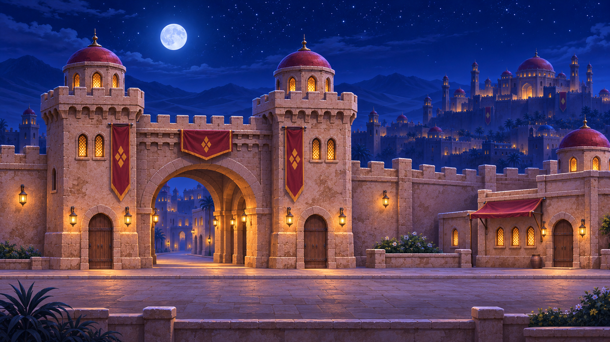
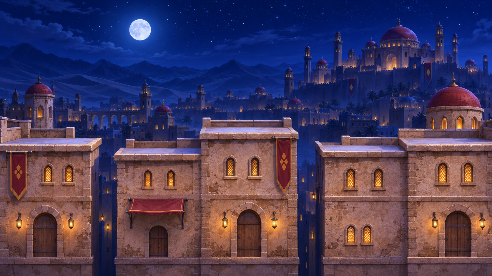

# Direção artística aprovada

Conceitos gerados pela ferramenta de imagens em05/11/2026, aprovados pelo dono.
Não são capturas do Godot nem representam a extensão inteira das fases.

O panorama posterior foi reprovado por falta de parkour e buracos. Não reutilizá-lo
como fase pronta. Integrar estes materiais em camadas e peças, mantendo personagens
3D oficiais, leitura lateral, obstáculos, vãos e colisões reais. Não substituir o
percurso por uma imagem esticada. Integração artística ainda pendente.
