# Biblioteca visual — lote grande

Dez módulos novos; quinze módulos no catálogo contando os anteriores.
**Assets aprovados integrados às dez fases pelo controlador existente. Capturas e validação da integração em `evidence/ten-approved`.**
As imagens desta página são assets isolados, não capturas de fases.

## Distribuição pelas dez fases

| Fase | Sequência de composição |
|---|---|
| 01 — Portões da Capital | 4%: torre de vigia com cúpula vermelha → 14%: arcada de passagem → 30%: casa residencial → 47%: casa de comerciante e loja de tecidos → 64%: palmeiras e jardim desértico → 81%: torre de vigia com cúpula vermelha → 94%: casa com varanda de madeira |
| 02 — Telhados da Capital | 4%: casa residencial → 23%: casa com varanda de madeira → 43%: casa de comerciante e loja de tecidos → 59%: torre de vigia com cúpula vermelha → 77%: casa com varanda de madeira → 94%: barraca de tecidos e cerâmicas |
| 03 — Bazar da Cidade | 6%: barraca de tecidos e cerâmicas → 22%: casa de comerciante e loja de tecidos → 37%: barraca de tecidos e cerâmicas → 52%: palmeiras e jardim desértico → 68%: casa de comerciante e loja de tecidos → 82%: barraca de tecidos e cerâmicas → 95%: arcada de passagem |
| 04 — Aqueduto do Deserto | 4%: arcada de passagem → 19%: módulo de aqueduto → 40%: módulo de aqueduto → 55%: fonte dos jardins do oásis → 73%: módulo de aqueduto → 94%: palmeiras e jardim desértico |
| 05 — Jardins do Oásis | 6%: palmeiras e jardim desértico → 24%: fonte dos jardins do oásis → 42%: palmeiras e jardim desértico → 58%: fonte dos jardins do oásis → 77%: palmeiras e jardim desértico → 95%: arcada de passagem |
| 06 — Ruínas Enterradas | 6%: ruínas e colunas antigas → 29%: ruínas e colunas antigas → 46%: minérios e cristais subterrâneos → 65%: ruínas e colunas antigas → 83%: minérios e cristais subterrâneos → 95%: arcada de passagem |
| 07 — Estrada da Mineração | 5%: torre de vigia com cúpula vermelha → 21%: ponte de madeira e pedra → 38%: guindaste e transporte de minério → 56%: ponte de madeira e pedra → 75%: guindaste e transporte de minério → 92%: minérios e cristais subterrâneos |
| 08 — Posto de Controle | 6%: torre de vigia com cúpula vermelha → 24%: portão militar de controle → 44%: torre de vigia com cúpula vermelha → 62%: arcada de passagem → 78%: torre de vigia com cúpula vermelha → 95%: portão militar de controle |
| 09 — Entrada da Mineradora | 6%: guindaste e transporte de minério → 25%: ponte de madeira e pedra → 45%: guindaste e transporte de minério → 64%: ponte de madeira e pedra → 82%: guindaste e transporte de minério → 100%: entrada monumental da mineradora |
| 10 — Interior da Mineração | 6%: guindaste e transporte de minério → 23%: minérios e cristais subterrâneos → 39%: ponte de madeira e pedra → 55%: guindaste e transporte de minério → 72%: minérios e cristais subterrâneos → 87%: guindaste e transporte de minério → 96%: minérios e cristais subterrâneos |

Os percentuais medem a jornada; o arquivo de posições resolve cada âncora no piso real, mantendo a largura dentro de uma superfície apoiada. Não são peças repetidas para preencher todo o percurso.
Na fase2, fachadas ficam abaixo da laje e o bazar aparece na rua inferior. O portal da mineradora só aparece no final da fase9. Na fase10, guindastes, passarelas e cristais compõem o ambiente subterrâneo.

## Assets

### Casa residencial

Fases: 01, 02. Largura sugerida: 6.0m. Recurso: `capital_house.res`.

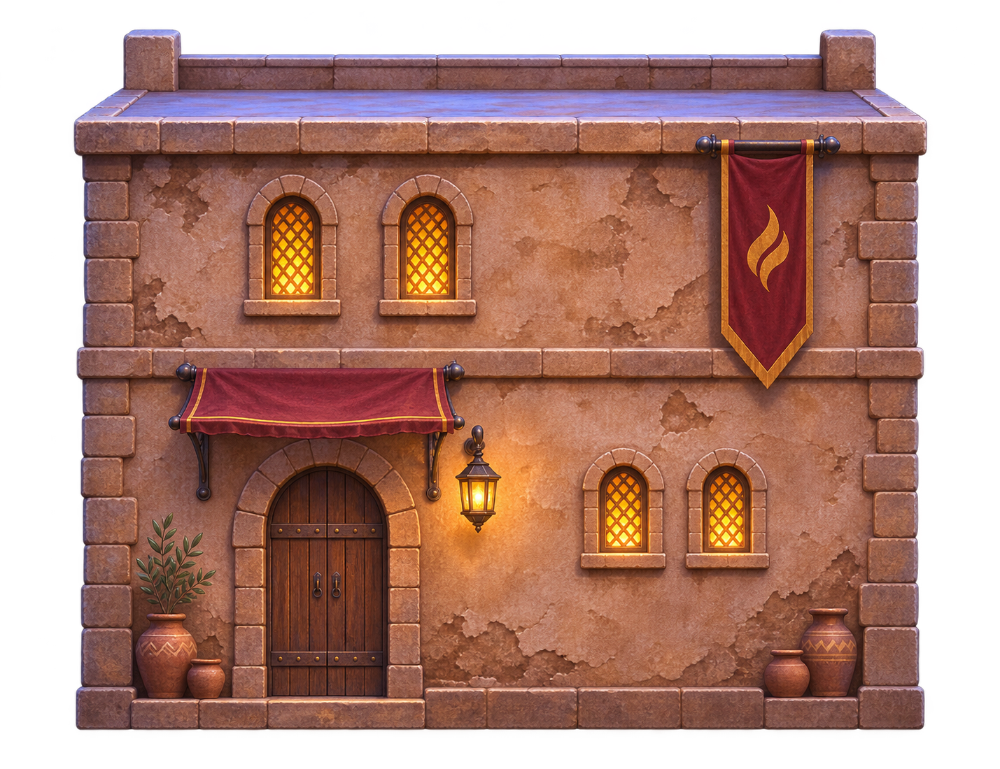

### Casa de comerciante e loja de tecidos

Fases: 01, 02, 03. Largura sugerida: 6.5m. Recurso: `capital_merchant.res`.

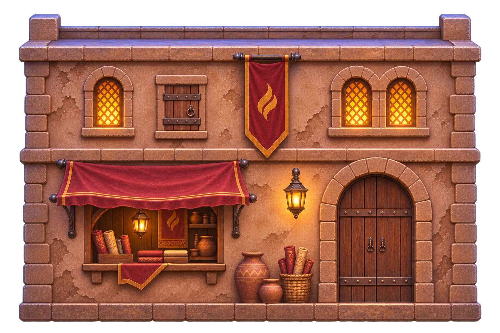

### Torre de vigia com cúpula vermelha

Fases: 01, 02, 07, 08. Largura sugerida: 3.2m. Recurso: `capital_watchtower.res`.

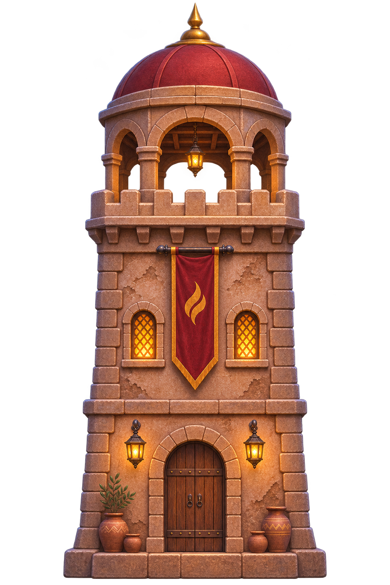

### Barraca de tecidos e cerâmicas

Fases: 02, 03. Largura sugerida: 3.2m. Recurso: `capital_market_stall.res`.

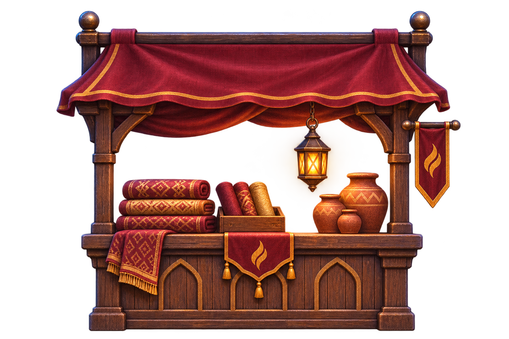

### Palmeiras e jardim desértico

Fases: 01, 03, 04, 05. Largura sugerida: 4.0m. Recurso: `capital_palm_garden.res`.

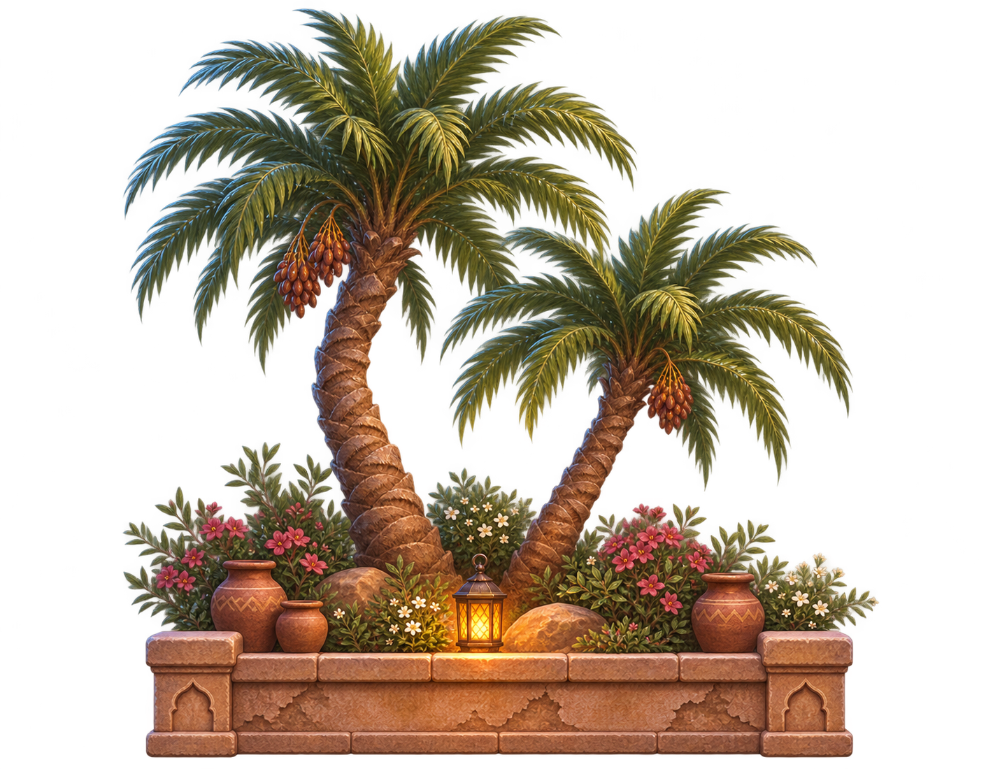

### Arcada de passagem

Fases: 01, 03, 04, 05, 06, 08. Largura sugerida: 4.5m. Recurso: `capital_archway.res`.

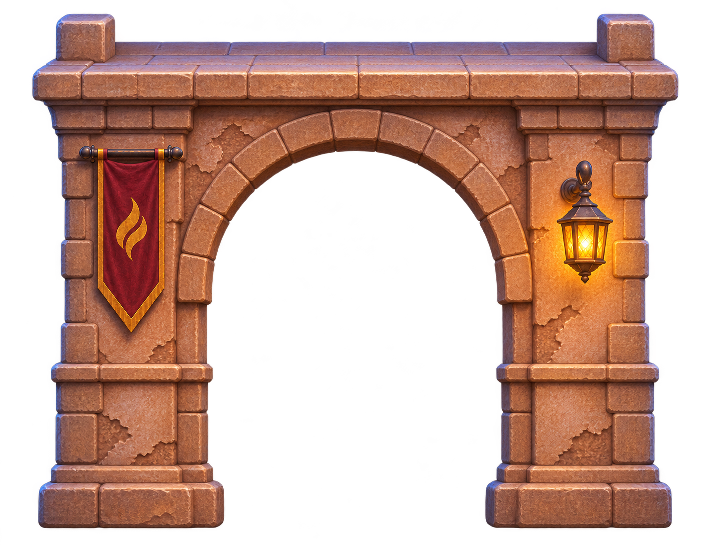

### Casa com varanda de madeira

Fases: 01, 02. Largura sugerida: 6.0m. Recurso: `capital_balcony_house.res`.

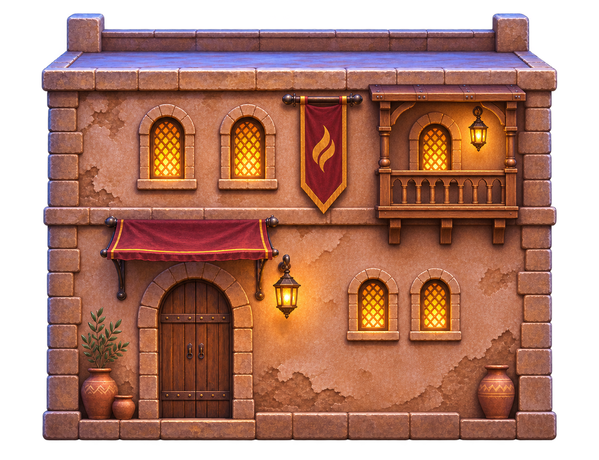

### Módulo de aqueduto

Fases: 04. Largura sugerida: 9.0m. Recurso: `desert_aqueduct.res`.

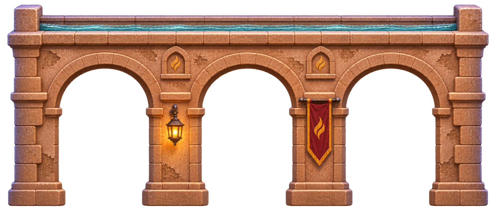

### Fonte dos jardins do oásis

Fases: 04, 05. Largura sugerida: 3.2m. Recurso: `desert_oasis_fountain.res`.

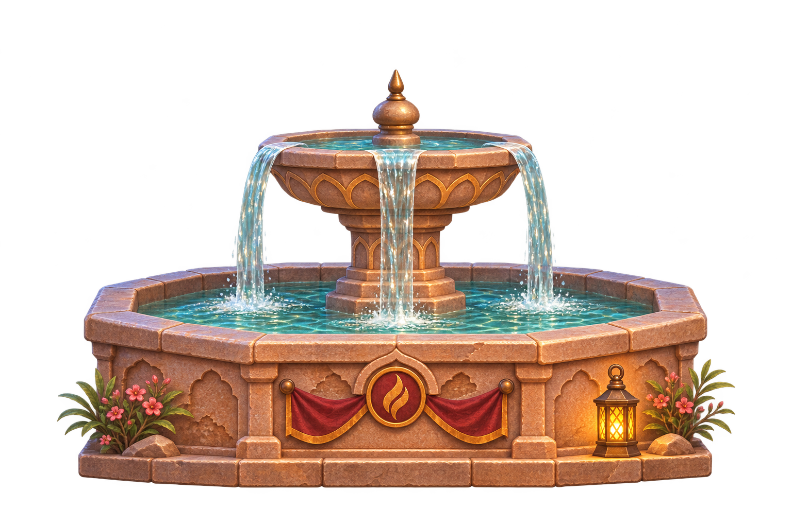

### Ruínas e colunas antigas

Fases: 06. Largura sugerida: 6.0m. Recurso: `desert_ancient_ruins.res`.

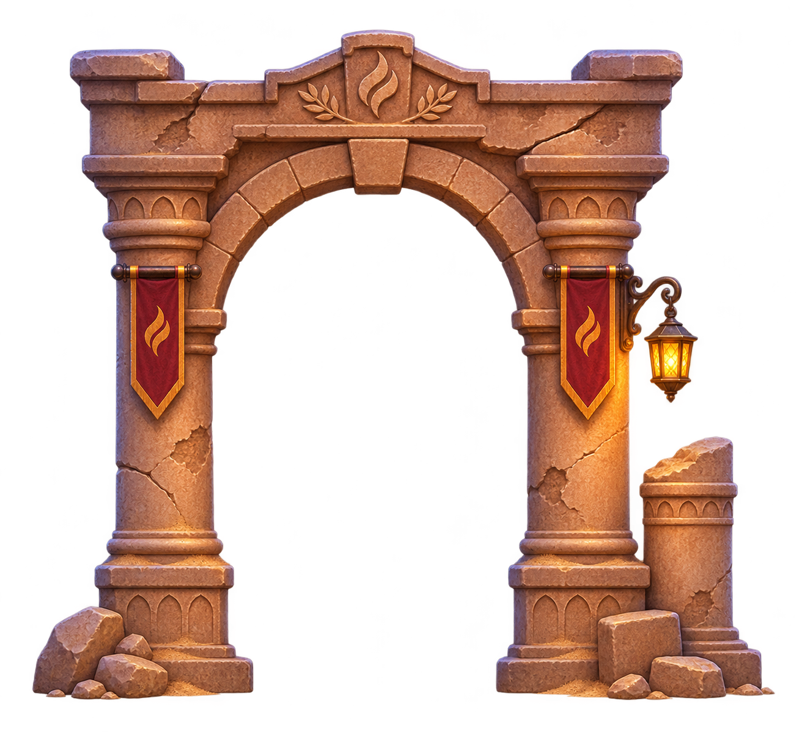

### Guindaste e transporte de minério

Fases: 07, 09, 10. Largura sugerida: 5.0m. Recurso: `desert_mining_gantry.res`.

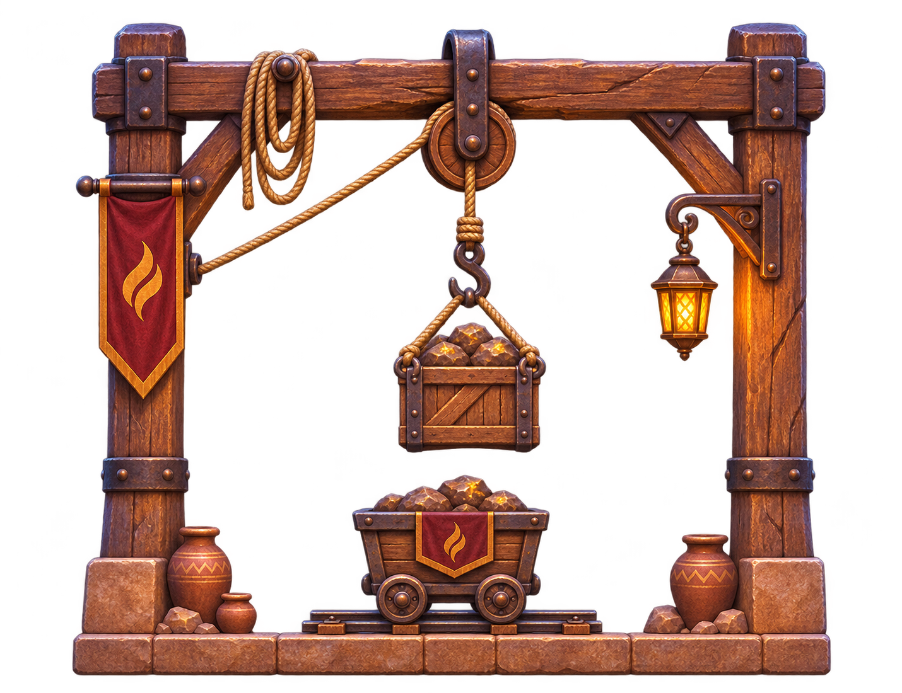

### Portão militar de controle

Fases: 08. Largura sugerida: 7.0m. Recurso: `desert_military_gate.res`.

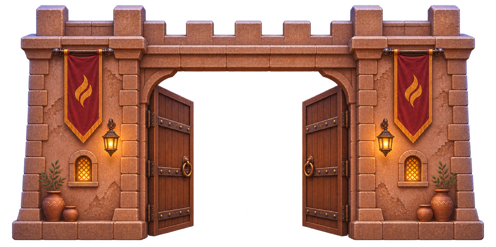

### Entrada monumental da mineradora

Fases: 09. Largura sugerida: 8.0m. Recurso: `desert_mine_entrance.res`.

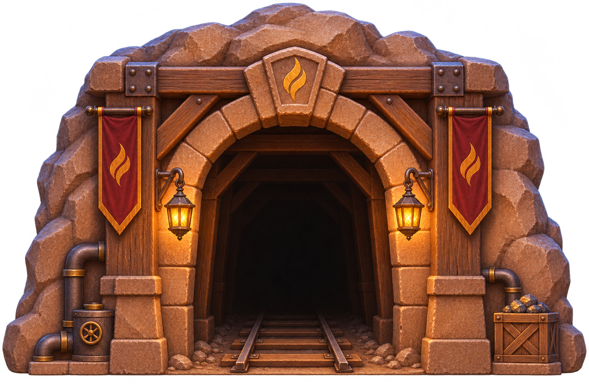

### Ponte de madeira e pedra

Fases: 07, 09, 10. Largura sugerida: 7.0m. Recurso: `desert_timber_bridge.res`.

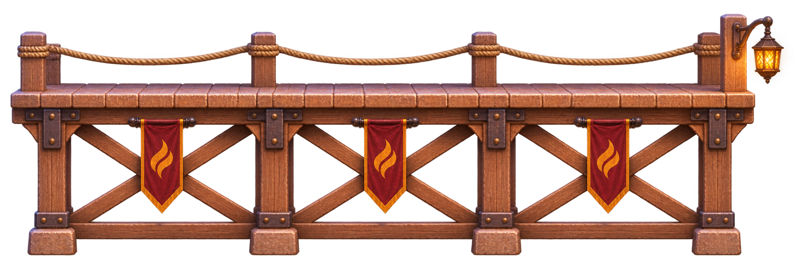

### Minérios e cristais subterrâneos

Fases: 06, 07, 10. Largura sugerida: 3.0m. Recurso: `desert_mine_crystals.res`.

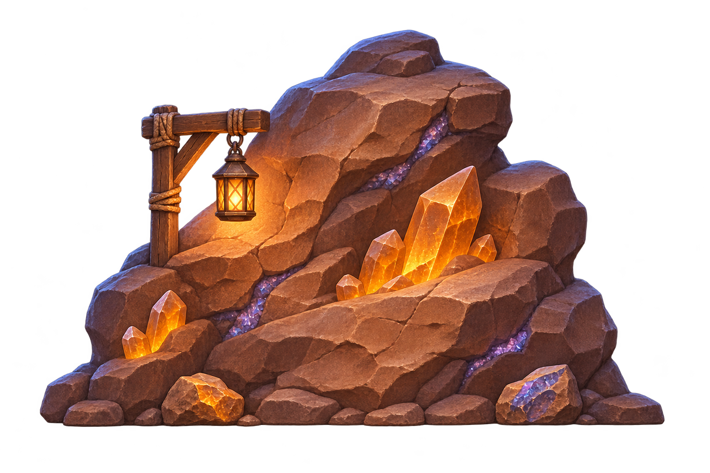

## Arquivos de montagem

- Plano editável: `assets/desert/modular/phase_asset_plan.json`.
- Posições resolvidas no Godot: `evidence/asset-library/placements.json`.
- Catálogo e escala: `assets/desert/modular/city_assets.json`.
- Fontes RGBA: `assets/desert/modular/source/`; excluídas da exportação.
- Texturas runtime `.res`: alfa, mipmaps, proporção preservada, maior dimensão1024.

## Regras da integração

A instalação usa trechos carregados sob demanda, com capturas reais do motor. Não criar colisões com a silhueta da imagem: conservar pisos3D e modelos oficiais, recortar fachadas/ponte por peça física, não esconder vãos, recargas, perseguição ou pisos de Ruptura. Água ilustrada não substitui a água animada existente. Rever alinhamento e profundidade na câmera real antes de marcar um asset como colocado.
