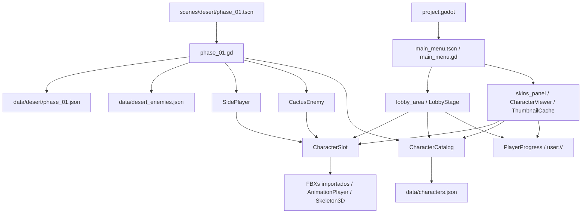

# Auditoria da base V3

Base inspecionada: `957fce550e8c4d0a71009b47e8f86e73d0780b19`, `origin/main`, em 28/10/2026. Trabalho em `codex/preparacao-offline-deserto`. Nenhum arquivo anterior da base foi modificado.

O repositório declara Godot 4.7, GDScript 2.0, renderização Compatibility e física Jolt. A orientação de `AGENTS.md` para executar as ferramentas do Godot foi substituída pela instrução explícita desta tarefa: não iniciar Godot. Não foram iniciados editor, importador, jogo, Blender ou serviços remotos.

## Estrutura encontrada

- 408 arquivos versionados na base; oito cenas, 16 scripts do jogo e 49 scripts do addon `godot_mcp`.
- `project.godot` inicia `scenes/menu/main_menu.tscn`; não há seção de autoloads configurada.
- `scripts/menu/`, `scripts/lobby/` e `scripts/skins/` implementam o menu, seleção de personagem, palco 3D e visualizador. As miniaturas são geradas no motor e guardadas em `user://thumbnails`.
- `scripts/progress/player_progress.gd` guarda flags locais de desenvolvimento em `user://progress_dev.cfg`; equipamento é salvo separadamente em `user://lobby.cfg`.
- `scenes/desert/phase_01.tscn`, `scripts/desert/` e `data/desert/phase_01.json` formam o protótipo lateral já existente: salto duplo, ataque, vida, inimigos Cactus, câmera, controles por toque e mensagem de conclusão. Esses sistemas não foram alterados.
- `data/characters.json` versão 2 contém sete personagens inicialmente jogáveis, um desbloqueável e `story_villains` vazio. `data/desert_enemies.json` mantém o Cactus fora do catálogo equipável.
- Há dez diretórios de personagens, 45 FBXs, dez OBJs, dois GLBs de acessórios e texturas/MTLs. O inventário completo está em [generated/assets.md](generated/assets.md).
- `tools/asset_pipeline/` contém os dois utilitários PowerShell existentes para arte da interface. Foram preservados e não executados.

## Dependências do jogo

O menu atual só trata a opção Skins no manipulador `option_selected`. A fase 1 existe, mas não foi localizada uma ligação de navegação a ela no menu. O grafo completo de referências literais e classes está em [generated/dependency_graph.json](generated/dependency_graph.json). Exemplos e caminhos opcionais do addon são classificados separadamente de referências obrigatórias do jogo. Caminhos de nós, cargas dinâmicas e resolução de classes pelo motor continuam fora da prova estática.

## Problemas e pendências confirmados por leitura

| Prioridade | Evidência | Consequência / próximo passo |
| --- | --- | --- |
| Alta | `characters.json`, `progress_contract.json` e `skins_panel.gd` usam `desert_stage_completed` | Não expressam a conquista requerida `desert_campaign_completed`; preparar migração coordenada, sem conceder automaticamente a conquista a saves antigos. |
| Alta | Só há fase 1; `_on_goal_entered` apenas mostra mensagem | Fases 2–10, persistência de conclusão e desbloqueio após a fase 10 ainda precisam de implementação. A fase 1 não concede a conquista. |
| Alta | Progresso local e botões DEV | São mecanismos de desenvolvimento, não autorização de produção. A arquitetura proposta exige validação no servidor. |
| Média | `main_menu.gd` só trata Skins | Navegação do Modo História não está conectada nesta base. |
| Média | `idle_verified=false` em oito entradas | Não atribuir idle/dança a `1.fbx`–`4.fbx` sem verificar a animação. A pose estática existente foi preservada. |
| Média | `CharacterSlot._first_animation_of` | Copia o primeiro clipe e mistura trilhas sem retarget explícito; confirmar nomes, caminho das trilhas, repouso e root motion no Godot. |
| Média | `pending_assets.malagueta` afirma ausência | O diretório contém modelos, texturas e cinco FBXs. O arquivo `ataque de baixo pra cima.fbx` é candidato de base com malha/skin; os outros quatro são animação sem malha. Não há chefe implementado. |
| Média | Esqueletos de 33, 41 e 65 ossos entre personagens | Mesmos nomes Mixamo não garantem retarget entre corpos. Dentro de cada personagem os nomes/parentesco são consistentes nos arquivos inspecionados. |
| Média | Caminhos de autoria de texturas nos FBXs | Separar textura realmente ausente, imagem embutida e candidato pelo nome local. Não declarar perda de textura só por um caminho antigo. |
| Média | Cenário da fase 1 usa caixas | Arte dos ambientes, checkpoints, efeitos, som e apresentação das dez fases estão pendentes. |
| Média | `load(model) as PackedScene` depende da importação | Um FBX cru baixado do R2 não é automaticamente um recurso carregável no jogo exportado. O pipeline de distribuição deve resolver isso. |

Nenhum inimigo/chefe foi incluído automaticamente em `playable` ou `unlockable`. Malagueta é exclusivamente o chefe final planejado da fase 10; Cactus é a tropa inimiga do Deserto. El Fuego é o protagonista das dez fases, disponível na campanha independentemente do bloqueio no lobby.

## Limites da auditoria

Foram lidos dados, cenas e scripts e inspecionada a estrutura binária dos modelos. Isso não confirma importação FBX no Godot 4.7, sintaxe GDScript pelo compilador do motor, aparência, retarget, colisões, câmera, alcance dos saltos, checkpoints, desempenho ou funcionamento em celular/Web. Não se atribui aprovação à versão jogável sem esses testes.

O relatório reproduzível inclui hashes dos 408 arquivos originais em [generated/audit_snapshot.json](generated/audit_snapshot.json). As verificações finais confrontam esses hashes para detectar qualquer regressão por alteração de fonte nesta tarefa.
