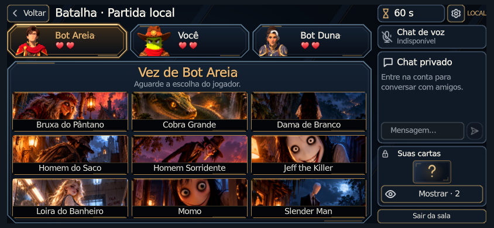

# Batalha — refinamento visual de 30/10/2026

**Estrutura aprovada preservada. Acabamento novo aguardando avaliação do usuário.**
Estas são capturas reais, não imagens conceituais. Não integrar automaticamente.

## Resultado em 844×390

[Antes desta rodada](../revisao-2026-10-30/844x390-battle.png) ·
[seleção](844x390-selection.png) · [cartas selecionadas](844x390-selected.png) ·
[confirmação — fixture](844x390-confirmation-fixture.png) · [mão aberta](844x390-private-hand.png).

Estados com fixture de apresentação: [dano](844x390-damage-fixture.png),
[eliminação/derrota](844x390-eliminated-fixture.png), [vitória](844x390-victory-fixture.png)
e [chat privado com transporte de teste](844x390-chat-fixture.png).
O teste modifica estados somente em memória para a captura; não altera regras ou catálogos.
Os botões e o fluxo local também são exercitados com o serviço real.

## Demais tamanhos

| Janela | Rodada | Confirmação (fixture) |
|---|---|---|
| 640×360 | [Abrir](640x360-battle.png) | [Abrir](640x360-confirmation-fixture.png) |
| 1920×1080 | [Abrir](1920x1080-battle.png) | [Abrir](1920x1080-confirmation-fixture.png) |
| 2532×1170, densidade 3 simulada | [Abrir](2532x1170-d3-battle.png) | [Abrir](2532x1170-d3-confirmation-fixture.png) |

Godot 4.7.2, Compatibility, Xorg/Mesa llvmpipe. Não representam Android físico.

## O que foi refinado

Retratos maiores e melhor recortados, nomes mais fortes, corações mais presentes,
relevo/sombra e reflexos controlados nos painéis e tabuleiro, realce dourado do jogador
da vez, dessaturação e retirada do destaque na eliminação, flash/escala breves no dano.

Cartas com bordas e tarjas refinadas, padding e marca de seleção. Os pontos focais
passaram a mostrar os sujeitos reais das ilustrações: o corte genérico anterior escondia
a cobra e cortava rostos. Nenhuma imagem foi redesenhada ou esticada.

Ambientação azul opaca com gradientes discretos; tipografia MSDF e peso moderado;
acabamento lateral coeso, SVGs rasterizados em 4× com mipmaps, olho mostrar/ocultar,
verso abstrato da mão privada e avisos laterais com fade.

[Lista dos arquivos e assets](../../../docs/referencias/batalha/POLIMENTO_VISUAL.md).
Reaproveitados: nove PNGs, retratos, fonte, ícones de vida e PlayerUI.
Assets novos: `eye_off.svg`, `private_back.svg`, overlay vetorial e shader de uma
amostra de textura. Nenhum personagem, carta jogável ou asset de terceiro foi criado.

## Verificação técnica

- [Smoke](smoke.json): **30/30 grupos**. Inclui fases, transições, funcional,
  navegação, Duelo, chat e menus. A apresentação foi repetida após a última correção visual.
- Apresentação gráfica: **392 verificações por tamanho**, zero falhas:
  [844](844x390.log), [640](640x360.log), [desktop](1920x1080.log), [densidade 3](2532x1170-d3.log).
- [Apresentação headless](battle_presentation.log): **383 verificações**, zero falhas.
- [Navegação](battle_navigation.log): 10; [Duelo local](duel_local.log): 54;
  [chat](chat_flow.log): 20 verificações, todas passaram.
- `python3 tools/player_ui/check_design.py` e `git diff --check`: passaram.
- Exportação Web: **57.274.432 bytes / 54,62 MiB** no `index.pck`.
- Chromium/SwiftShader em 844×390 com toque emulado: criação local, bot, início,
  três seleções, confirmação, rodada e mão aberta. [Seleção](web-844x390-selected.png),
  [rodada](web-844x390-battle.png), [mão](web-844x390-hand.png).
  O [registro](web-local.json) não contém novos erros durante a batalha.

## Limites

Na inicialização Web local persistem os erros da interface opcional `QSE_PUBLIC_CONFIG`
e do certificado na consulta pública ao catálogo remoto. Nenhuma credencial ou configuração
remota foi alterada. O exportador terminou, mas registrou erros de detecção Vulkan do
ambiente antes de exportar em Compatibility. Não se declara exportação com log limpo.
As mídias externas de menu/carregamento foram copiadas como no workflow de deploy.

Não houve validação em Android/iPhone físico, GPU móvel, conta online autenticada,
sala remota ou áudio em aparelho. SwiftShader não serve como medição de FPS móvel.
O chat continua privado entre amigos; voz e links de convite continuam indisponíveis.

Os casos de 30 cartas/20 participantes são fixtures de geometria, sem aprovação de
legibilidade equivalente a nove cartas. A comparação visual final é com a imagem
anexada pelo usuário e depende de sua avaliação. Testes técnicos não aprovam estética.
