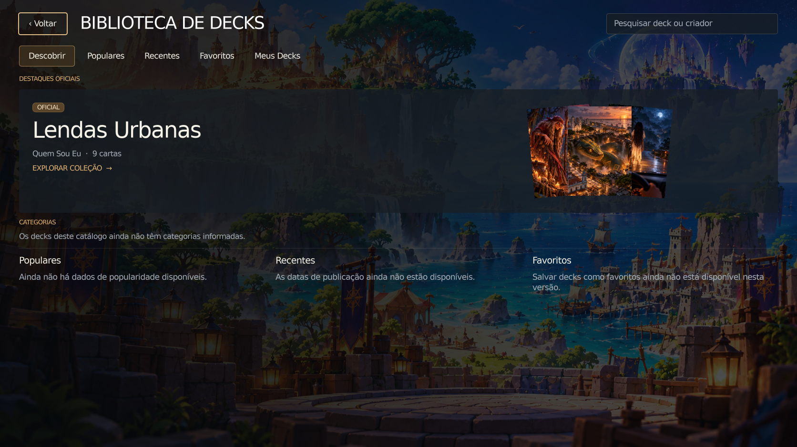
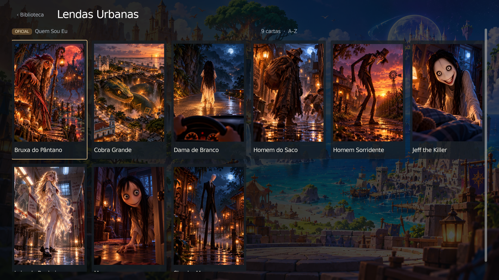
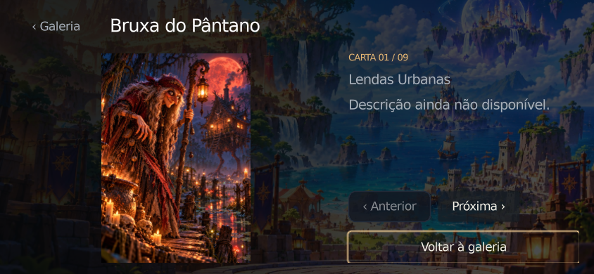

# Biblioteca — capturas reais

Framebuffers Godot, sem montagem ou redesenho. Inspecionados visualmente em três resoluções; as nove cartas usam os PNGs existentes. A comparação visual seguiu a direção limpa do PR #28.

| Ambiente de janela | Biblioteca | Lendas Urbanas | Leitor |
| --- | --- | --- | --- |
| Desktop · 1672×941 | [Abrir](desktop/library.png) | [Abrir](desktop/deck.png) | [Abrir](desktop/reader.png) |
| Landscape · 844×390 | [Abrir](mobile/library.png) | [Abrir](mobile/deck.png) | [Abrir](mobile/reader.png) |
| Landscape compacto · 640×360 | [Abrir](small/library.png) | [Abrir](small/deck.png) | [Abrir](small/reader.png) |

Motor disponível: **Godot 4.6.3 stable oficial**, Compatibility/OpenGL, Mesa llvmpipe, Xvfb/Linux. O projeto declara 4.7. Estas capturas validam apresentação e interação no motor em tamanhos landscape, **não execução num aparelho Android nem no navegador**. Não foram exportados APK ou Web, nem medidos GPU, memória e tempo de resposta em aparelhos físicos.

Os detalhes funcionais e limites estão em [BIBLIOTECA.md](../../docs/decks/BIBLIOTECA.md). Logs desta execução ficam em `validation/`.

## Resultado da validação

- Biblioteca: **67 verificações por resolução**, incluindo imagens, busca, galeria, leitura, metadados, limites de controles e navegação; três resoluções sem falhas funcionais. Capturas inspecionadas nas três resoluções.
- Navegação existente: **27 verificações**, sem falhas, incluindo História, Duelo, Personagens, Amigos, Configurações e retorno da pilha.
- Duelo local: **54 verificações**, sem erros de script ou recursos após corrigir o retorno da sala e o descarte de nós da interface. Regras de partida preservadas. O teste agora libera a tela e os serviços ao terminar.
- Configurações: **28 verificações** sem falhas. Fluxo de Música e suíte de áudio existentes passaram nesta branch.
- Importação pelo editor Godot e `tools/player_ui/check_design.py`: concluídas sem erros. A verificação de design agora cobre também `scripts/decks`.
- Os hashes em `validation/original-images.json` confirmam os nove PNGs idênticos aos da `main`.

A suíte extra de reprodução local de Música **não ficou verde**: falharam início da fixture, próxima/crossfade e anterior. As mesmas três falhas ocorreram num checkout separado da `main` `cf51c28`, sem as mudanças desta Biblioteca; logs dos dois cenários estão anexados. A suíte de áudio da comparação também apresentou uma falha de tempo no crossfade, embora tenha passado nesta branch. Não foram alterados player, catálogo ou arquivos de áudio para mascarar essas falhas.

Algumas execuções da Biblioteca e do teste legado de navegação emitiram `ObjectDB instances leaked at exit` no encerramento, sem erro de script nem falha funcional; o aviso permanece registrado nos logs. Isso não constitui medição de memória ou performance em dispositivo real.

Ao atualizar com a `main` `e82c6ac` (PR #30), a regressão do Duelo revelou acesso a uma sala já limpa e nós de interface sem dono. Foram corrigidos o estado de retorno, a posse do seletor de privacidade oculto na partida local e a liberação da prévia destacada. O teste do Duelo voltou a encerrar sem erros de recursos.
