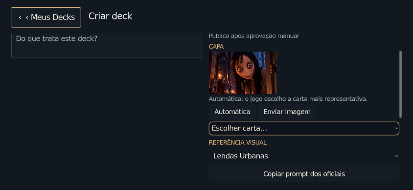
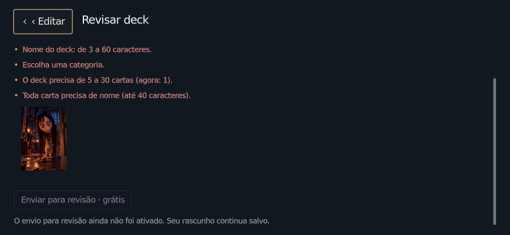

# Criador e revisão manual de decks — 05/11/2026

Implementação em `work/decks-revisao-repositorio`, Godot **4.7.2 oficial**.
Os testes abaixo usam contas, JWTs, servidor GitHub e imagens identificados como
fixtures; nenhum acesso ao Supabase, upload real ou publicação do Worker.
O catálogo aprovado real continua vazio. As imagens coloridas não são novos
assets do jogo nem decks publicados; a carta Momo vem dos assets oficiais existentes.

## Resultados executados

| Verificação | Resultado |
|---|---|
| Ponte Node 24: JWT RS256 e ES256, autenticação, isolamento, limites, concorrência, repetição e retomada de publicação | 2 cenários, 0 falhas |
| Fluxo nativo: pacote/capa WebP, originais preservados, aviso sem ponte, atualização de status, papéis e decisão | 16 verificações em cada uma das três resoluções, 0 falhas |
| Deck aprovado temporário: Biblioteca, nome/capa, recortes, sala local, bot e seleção de cartas | 14 verificações, 0 falhas |
| Editor/rascunhos T21, incluindo prompt e referência oficial | 48 verificações, 0 falhas |
| Sincronização antiga, favoritos locais de repo e separação de contas | 24 verificações, 0 falhas |
| Fluxo antigo de comunidade T27 | 13 verificações, 0 falhas |
| Duelo local existente, seleção/turnos até o fim | 85 verificações aprovadas |
| PWA no Chromium local, cache e atualização | 29 verificações, 0 falhas |
| `tools/player_ui/check_design.py` | OK |
| Validador offline do catálogo | OK; catálogo real vazio |
| Export Web release oficial 4.7.2 | HTML, PCK e WASM gerados; sem erros de script/import/export |

Logs curtos das execuções ficam nesta pasta. O teste de catálogo temporário
restaura o manifesto e apaga apenas sua pasta ao terminar; nenhuma fixture
entra no manifesto real. A regressão PWA usa o shell de teste existente; não
equivale a um envio real entre navegador, Worker e GitHub.

## Capturas reais do motor

Perfil padrão 1672×941; somente as duas capturas menores usam `--iphone` e base
1200×675. Há rolagem no conteúdo da revisão; as ações cabem e ficam acessíveis
ao rolar. Não foi alterada a regra de escala dos demais dispositivos.

| Tela | Desktop | 844×390 | 640×360 |
|---|---|---|---|
| Revisão, início | [imagem](1672x941_moderacao.png) | [imagem](844x390_moderacao.png) | [imagem](640x360_moderacao.png) |
| Aprovar/reprovar | [imagem](1672x941_moderacao_acoes.png) | [imagem](844x390_moderacao_acoes.png) | [imagem](640x360_moderacao_acoes.png) |
| Autor sem poderes de moderação | [imagem](1672x941_autor.png) | [imagem](844x390_autor.png) | [imagem](640x360_autor.png) |

Editor existente com as novas ações:

## Limitações observadas e ativação

- **O serviço de envio não está publicado/configurado.** `api_url` vazio mantém
  o envio desativado com mensagem explícita. Falta hospedar a ponte, cadastrar
  seus secrets no provedor e indicar o ID público QSE do moderador. Instruções
  em [services/deck-repository](../../services/deck-repository/README.md).
- Não foram executados upload/aprovação em produção nem o deploy Pages deste
  recurso. Aprovar em produção vai gerar um commit próprio e um deploy posterior.
- Decks do repositório funcionam na Biblioteca/local após entrar no build. Para
  duelo online, o responsável pelo backend precisa importar o catálogo; existe
  um exportador JSON offline, sem SQL nem alterações no Supabase.
- Sem validação em iPhone físico ou Safari. Capturas do motor não comprovam isso.
- Xvfb/Mesa informou V-Sync indisponível; a captura antiga do editor informou
  duas instâncias ObjectDB ao encerrar. Nenhum erro de script foi encontrado
  nessas capturas. A exportação oficial terminou sem erros.

Não há geração de imagens automática, integração de pagamentos ou cobrança
nesta versão. Criação manual e revisão têm preço zero no jogo.
