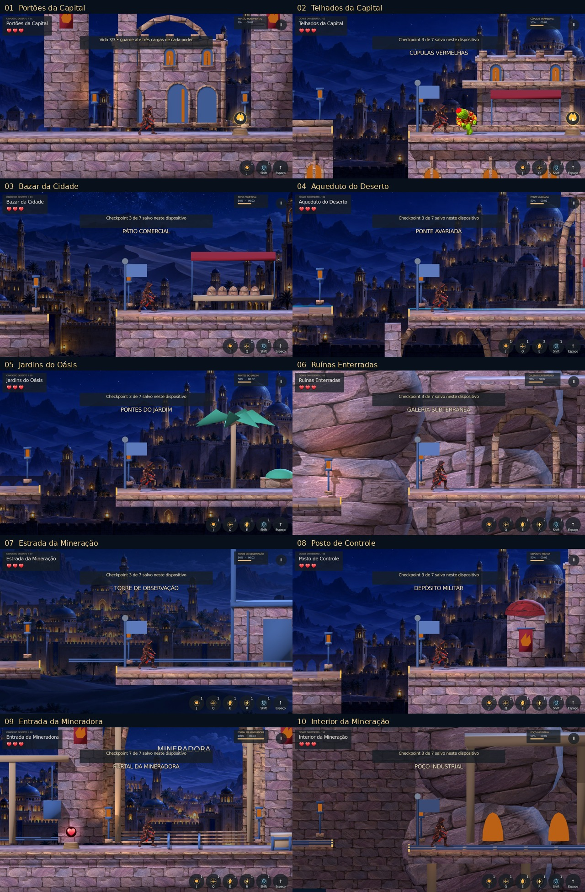

# Reino do Deserto — dez fases

Godot4.7.2 oficial; branch `work/reino-deserto-10-fases`. Sem merge/main/Pages.

## Evidências

- `qa/results.json`: 17 etapas aprovadas; dez rotas completas + seis suítes + controles.
- `qa/route-*.json` e logs: entradas físicas reais, sem teleporte/invulnerabilidade.
- `qa/reino10.log`:67/0; layout130/0; chefe6/0; progresso30/0; variedade15/0;
  checkpoints21/0; ações10/0. Guarda iPhone504/0, intro67/0, PWA29/0.
- `captures/`:63 imagens do motor, em desktop1672×941, iPhone844×390 e640×360.
  Início e ponto intermediário das dez fases, mais portal final9. Intermediários
  e portal são fixtures teleportadas, identificadas em capture.json.
- `web/report.json`: Chromium com UA iPhone,844×390,DPR3. Toque nos oito quadros,
  dash, persistência após reload e perseguição no telhado; listas de erros vazias.
- `qa/import.log`: importação normal autorizada concluída. Export de produção
  concluído; fixture Web separada, excluída de produção.
- `qa/landing_diagnostic_before.log` reproduz o defeito ANTES da correção de
  separação aérea; não representa uma falha da execução final.

O painel usa imagens inteiras sem deformação; fase1 no início,2–8 e10 no meio,
9 na saída. As capas nativas são capturas adicionais sem HUD.

## Reproduzir

Use o binário oficial Godot4.7.2 e templates Web correspondentes.
`python3 tests/desert_night/run.py --help` lista suítes/rotas e isolamento dos saves.
`tests/desert_night/capture_reino10.py` executa a galeria com Xvfb.
`tests/desert_night/web_desert_probe.cjs` testa o export separado da fixture.
Execute também `python3 tools/player_ui/check_design.py`,
`python3 tests/desert_night/scope_test.py` e `node tests/web_pwa/sw_test.js`.

## Limitações

Revisão artística e balanceamento continuam necessários: as capturas mostram
geometria real, mas não comprovam acabamento equivalente à referência. Rotas do
piloto levam ~4min08–4min39 simulados. Não são medições de FPS em aparelhos.
Safari/PWA físico, Android, Windows e serviços online não foram validados.
Nenhum asset de personagem, Supabase, autenticação ou player musical alterado.
