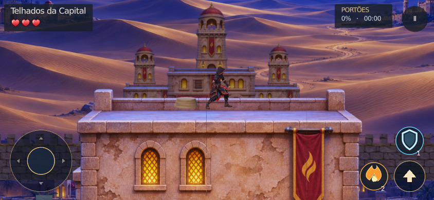
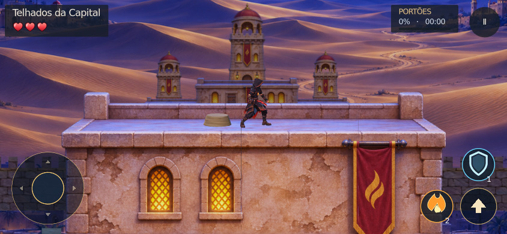
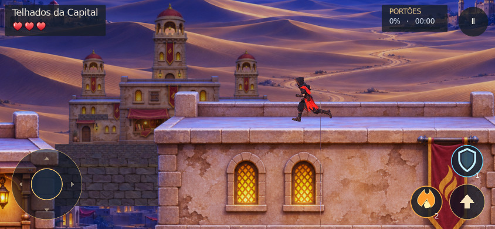
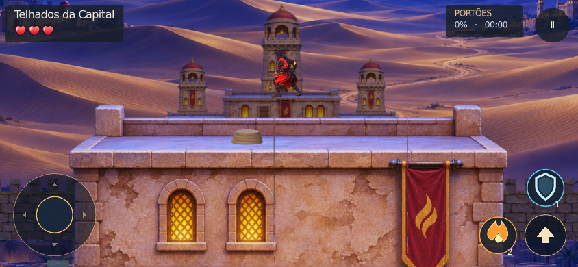
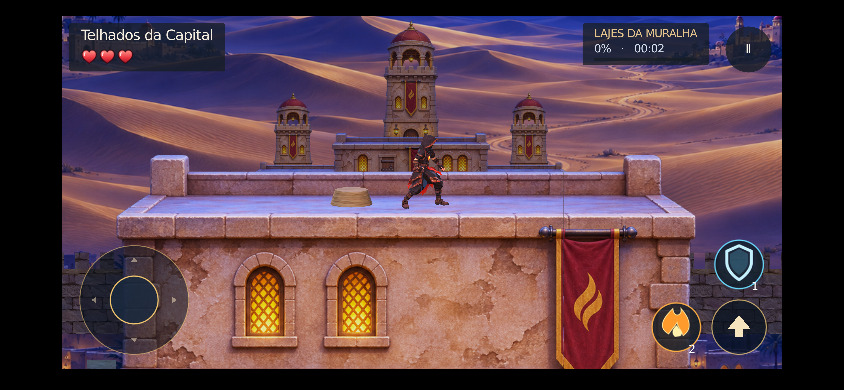

# Pés apoiados no teto visível

Correção sobre a main `f0c088e`, sem mudar modelos, altura do personagem, câmera, colisões, saltos ou movimentação.

## Causa e correção

`kingdom_assets.gd` fornece cada casa como um AtlasTexture recortado. `_house_roof_slice()` criava outro AtlasTexture dentro desse primeiro. No renderizador Sprite3D, esse aninhamento perdia o deslocamento do recorte original: a laje azul aparecia abaixo do plano de colisão. Verificar apenas `is_on_floor()` e a altura dos ossos não detectava o erro de imagem.

O recorte agora aponta diretamente para a textura base e soma o deslocamento UV original. Continua usando os mesmos assets, filtro, proporção, mipmaps, divisão por trechos e posição física. Nenhum custo de processamento contínuo ou asset novo.

## Evidência gráfica

Capturas reais no Godot 4.7.2 Compatibility, nas três resoluções. A aproximação inicial usa fixture; corrida e salto usam entradas físicas. A pose real é congelada somente ao salvar a captura.







## Validação

- **90 verificações gráficas aprovadas:** 30 em 1920×1080, 30 em 844×390 com perfil iPhone e 30 em 640×360. Incluem duas variantes de casas, ambos os sentidos de corrida, borda e salto.
- O teste lê os pixels do frame renderizado na altura física do piso: devem corresponder às lajes azuis, não à mureta quente. Também mede a sola da malha com o esqueleto aplicado; esse bake é apenas de diagnóstico, não faz parte do jogo.
- **Controle negativo:** a opção de fixture `--legacy-atlas` restaura o aninhamento antigo e produz **12 falhas visuais**, mantendo contato físico e salto válidos. Isso demonstra que a regressão detecta o problema que os testes anteriores deixavam passar.
- **75 verificações de colisão/cenário aprovadas**, incluindo vãos realmente abertos, alturas de aterrissagem e ausência de piso extra sobre as casas.
- **Percurso completo da fase 2 aprovado** pelo runner existente, em física fixa de 60 Hz, sem teleporte ao percorrer o mapa. `route-results.json` e `route-02.log`.
- **Web real:** export isolado no Chromium/WebGL2, viewport 844×390, DPR 3, user-agent iPhone. Entradas reais para direita/esquerda, três capturas e nove amostras de piso aprovadas. Nenhum erro JavaScript/Godot ou chamada externa bloqueada; o console registra um 404 de recurso de página. Não foi teste em Safari, iPhone físico ou APK, nem benchmark de FPS.
- Importação do projeto, verificação de design, escopo e `git diff --check` aprovados.
- O workflow de smoke agora executa a regressão gráfica mesmo quando o smoke geral falha nas pendências anteriores; capturas e medições ficam no artefato `roof-contact-real-render`. Nenhuma verificação antiga foi removida ou enfraquecida.

## Reproduzir

Com display disponível:

```sh
QSE_TEST_IPHONE=1 godot --path . --audio-driver Dummy --max-fps 30 \
  --script tests/desert_night/roof_contact_render.gd -- \
  /tmp/roof-contact 844x390 --touch-controls
```

Para reproduzir o defeito antigo só na fixture, acrescentar `--legacy-atlas`; a saída deve ser 1 com falhas de pixels. Desktop e 640×360 usam a mesma chamada sem a variável de perfil iPhone.

O teste Web usa a cópia isolada já documentada em `tests/desert_night/make_web_fixture.gd`, servida em localhost:8135, e requer Playwright/Chromium e Pillow:

```sh
QSE_ROOF_WEB_OUT=/tmp/roof-contact-web node tests/desert_night/web_roof_contact_probe.cjs
```
