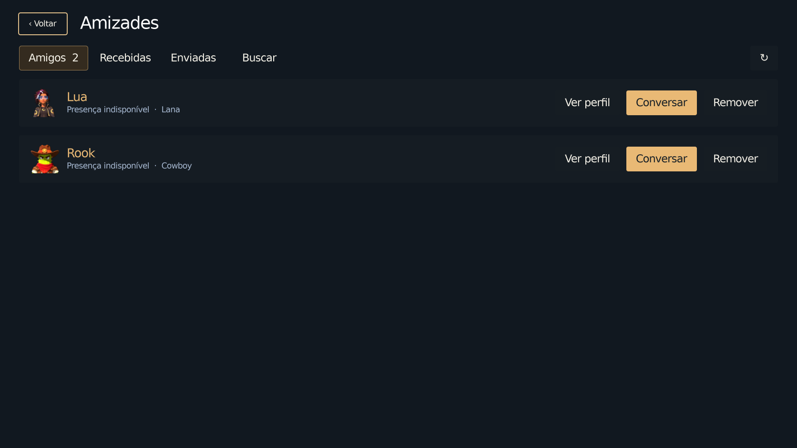
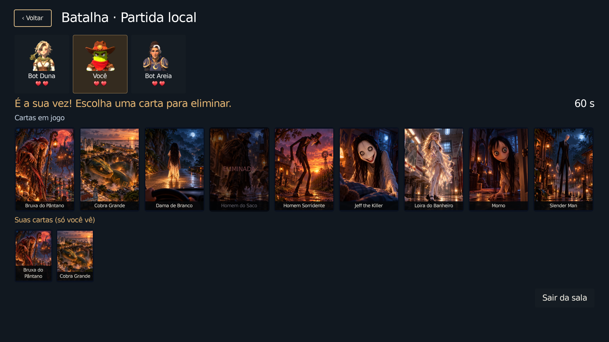

# Telas internas sólidas e avatares no Duelo

Base: `main` em `46d9b89`, após os PRs #36 e #37. O chat continua habilitado por padrão; serviços, gateway e regras não foram reimplementados.

A imagem do lobby foi retirada das telas internas. O `PlayerScreen` oculta e descarrega o Backdrop, e o `PlayerUI` pinta o fundo opaco `#111820`. Foram removidas as transparências específicas de Configurações, Personagens e História; nesta última, a arte das fases fica nos cartões. Ao abrir uma tela interna, seu fundo cobre o lobby imediatamente e apenas o conteúdo anima.

Os oito personagens equipáveis agora têm retratos PNG distribuídos em `assets/portraits`, renderizados dos próprios modelos 3D. Não é preciso visitar Personagens nem possuir arquivos em `user://` para ver o avatar em Amizades, na sala, nos participantes ou no resultado do Duelo. IDs desconhecidos continuam com fallback seguro. O seletor visual do chat usa diretamente a textura, sem criar um controle temporário só para obter seu ícone.

No Duelo, os avatares têm mais destaque e a grade usa a largura disponível: as nove cartas cabem numa única linha no desktop de referência. No landscape compacto há rolagem vertical para as cartas restantes; a instrução da vez usa tamanho adequado à largura. Não houve mudança de regras, cartas privadas, seleção, turnos ou chat.

## Capturas reais

Framebuffers do Godot, sem montagem, com fontes MSDF e imagens originais. Capturas inspecionadas em 1672×941, 844×390 e 640×360. As amostras do fundo nos PNGs confirmam RGB 17/24/32 e alfa 255.

| Janela | Amizades | Conversa | Sala do Duelo | Batalha | Configurações | Biblioteca | Música |
| --- | --- | --- | --- | --- | --- | --- | --- |
| 1672×941 | [Ver](desktop/friends.png) | [Ver](desktop/chat.png) | [Ver](desktop/duel-room.png) | [Ver](desktop/duel-match.png) | [Ver](desktop/settings.png) | [Ver](desktop/deck_library.png) | [Ver](desktop/music.png) |
| 844×390 | [Ver](mobile/friends.png) | [Ver](mobile/chat.png) | [Ver](mobile/duel-room.png) | [Ver](mobile/duel-match.png) | [Ver](mobile/settings.png) | [Ver](mobile/deck_library.png) | [Ver](mobile/music.png) |
| 640×360 | [Ver](small/friends.png) | [Ver](small/chat.png) | [Ver](small/duel-room.png) | [Ver](small/duel-match.png) | [Ver](small/settings.png) | [Ver](small/deck_library.png) | [Ver](small/music.png) |





As partidas das capturas foram jogadas pelo teste local contra os bots reais do jogo. Amigos e mensagens são fixtures identificadas do teste existente do chat, com transporte simulado; não representam contatos de produção ou mensagens enviadas a contas reais.

## Validação

- 21 verificações novas: oito retratos corretos sem cache, resolução e alfa, IDs inválidos/desconhecidos e fundo compartilhado opaco sem imagem do lobby. Incluído no runner de smoke para próximas execuções de CI.
- 54 verificações do Duelo local em cada resolução: sala, seleção, turnos, confirmação, revelação, fim e saída. Sem erros de script.
- 20 verificações do chat em cada resolução: abrir, enviar/receber pelo fixture, erro, sessão, expiração, foco e retorno. Nenhuma mudança no protocolo ou na ativação padrão.
- 27 verificações de navegação e 28 de Configurações passaram.
- Importação e `python3 tools/player_ui/check_design.py` passaram. O cache de miniaturas foi isolado por execução; a validação dos retratos verifica o recurso empacotado.

Motor disponível: Godot **4.6.3** oficial, Compatibility/OpenGL/Mesa llvmpipe em Xvfb/Linux. O projeto/CI especifica 4.7.2. Não houve execução local no 4.7.2, navegador ou Android físico, nem exportação ou medição de performance nesses dispositivos. O smoke completo de fases não foi repetido localmente; os testes direcionados acima foram executados. Avisos de VSync do Xvfb e de ObjectDB no encerramento de alguns testes legados estão preservados nos logs; os logs finais não têm erros de script ou recursos.

## Reproduzir

```sh
godot --headless --editor --path . --import --quit
python3 tools/player_ui/check_design.py
godot --headless --path . --script tests/presentation/solid_interiors.gd
godot --headless --path . --script tools/godot/menu_flow.gd
godot --headless --path . --script tests/settings_t14b/verify.gd
# Com display; criar a pasta antes do teste do chat.
godot --path . --script tests/duel_local/flow_test.gd -- /tmp/duelo 1672x941
mkdir -p /tmp/chat
godot --path . --script tests/chat/flow_test.gd -- /tmp/chat 1672x941
godot --path . --script tools/godot/capture_solid_interiors.gd -- /tmp/telas 1672x941
# Repetir com 844x390 e 640x360 para as janelas compactas.
```

Para refazer os retratos quando os modelos mudarem: `godot --path . --script tools/godot/bake_portraits.gd` com um display. A ferramenta usa o palco e a iluminação do jogo, faz enquadramento de busto a partir dos pixels opacos e salva até 720 px de altura, sem ampliar imagens menores. Os PNGs têm mipmaps e filtragem linear; não há redução de perfis gráficos para esconder problemas de qualidade.

Se os modelos ou a iluminação forem alterados, incremente `ThumbnailCache.VERSION` antes de refazer os retratos, conforme o contrato do pipeline existente, ou execute a ferramenta com dados de usuário de teste novos.
