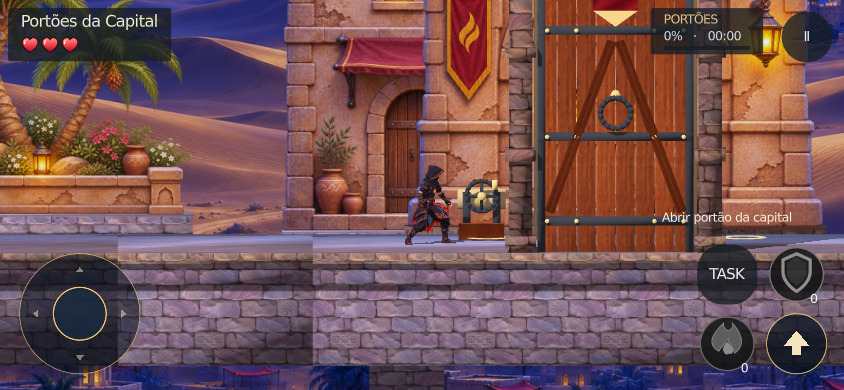
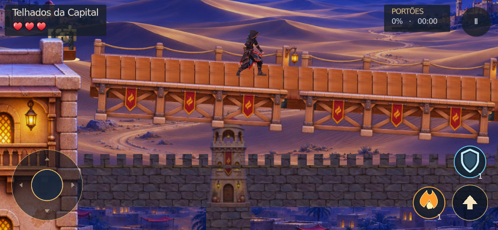
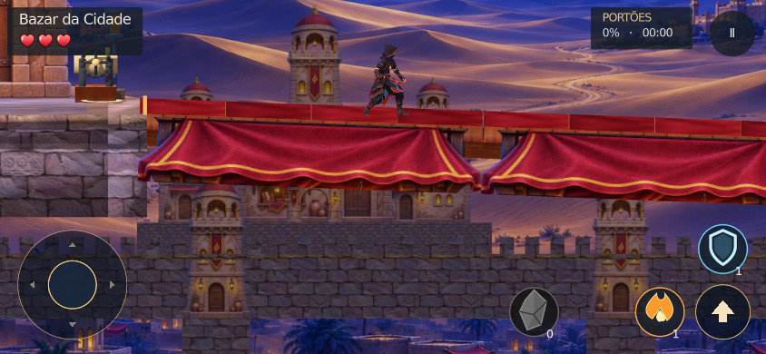
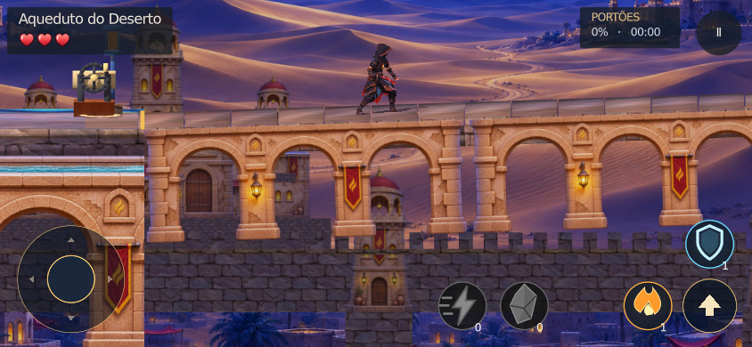
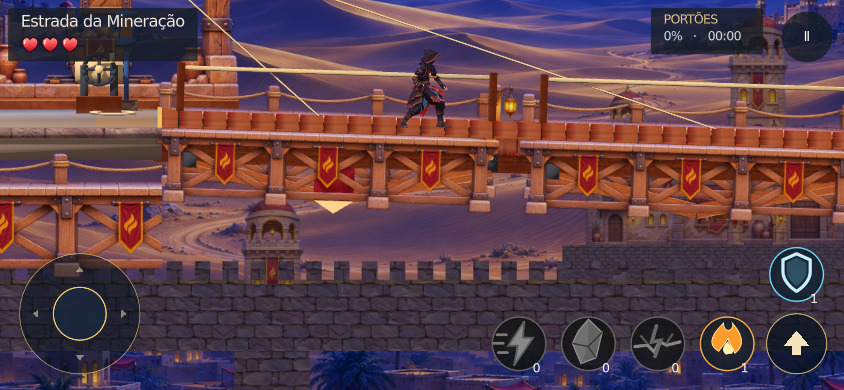

# Arte dos mecanismos das Tasks

Revisão da branch `codex/tasks-obrigatorias-tutorial` (base `8e20c3d`).
As capturas desta pasta são renders reais do Godot 4.7.2 Compatibility, não conceitos gerados.
O personagem foi aproximado por fixture; câmera, cenário, HUD e mecanismos são os do jogo.

## Mudanças visíveis

- Portões: tábuas texturizadas, travessas, rebites, anel, guias de pedra e guincho; portal das ruínas com blocos e inscrição.
- Pontes: peças curtas com a treliça ilustrada aprovada, piso de tábuas, cordas e ferragens. A montagem ocorre por seções em vez de girar uma laje gigante diante da câmera.
- Bazar: tecido, dobras e bordado do toldo já aprovado, sobre uma passagem reforçada.
- Aqueduto e ruínas: alvenaria e arcos do catálogo, substituindo a laje lisa e os apoios provisórios.
- Oásis: troncos amarrados, veios de madeira e pequenos galhos.
- Plataformas de carga: treliça, guindastes, cordas que acompanham o içamento, ferragens e guarda-corpo ao fundo.

O refinamento não muda dimensões/posições dos colisores, duração de 0,8s, custos, sinais, persistência, botão contextual ou tutoriais. Os bloqueios continuam obrigatórios. Não foram alterados casas, telhados, terreno, personagens, controles, UI ou serviços.

## Arte reaproveitada

| Recurso existente | Uso nos mecanismos |
| --- | --- |
| `desert_timber_bridge.res` | Treliças, cordas, lanternas e recorte UV de madeira |
| `capital_market_stall.res` | Toldo bordado e tecido de estandartes |
| `capital_archway.res` | Portais e molduras |
| `desert_aqueduct.res` | Arcos de pedra sob as passagens |
| `desert_mining_gantry.res` | Guinchos nas margens das plataformas de carga |
| `stone_masonry.res` | Alvenaria de portões, guias e lajes |

Não há novas imagens de jogo, modelos externos ou texturas geradas. A nova geometria decorativa está em `scripts/desert/t15d/task_art.gd`. Os recortes são AtlasTexture/UV em tempo de execução, preservando proporção. Materiais são exclusivos das Tasks; não alteram a paleta compartilhada do cenário. Não há novas luzes nem `_process` permanente; só os cabos são atualizados durante os 0,8s de içamento. Geometria agrupada por material e texturas compartilhadas.

## Capturas

- [`iphone/`](iphone/): 20 imagens em **844×390**, perfil iPhone e controles de toque, dez exemplos de portão/ponte/elevador antes e depois.
- [`desktop/`](desktop/): seis imagens em **1920×1080**, portão, ponte e plataforma de carga.
- [`640/`](640/): seis imagens em **640×360**, com controles de toque.
- Cada diretório tem `captures.json`, incluindo contato real com o piso após a aproximação.







São capturas do motor em Linux/Mesa por software. Não representam teste em iPhone físico, Safari ou APK e não comprovam FPS no aparelho.

### Web real

Export Web com template oficial 4.7.2, executado localmente em Chromium/WebGL2 por software, viewport **844×390, DPR 3**, toque e user-agent iPhone. `web/` contém seis capturas e `report.json`.

O teste existente `tests/desert_night/web_scenario_probe.cjs` passou, sem alteração: ativou portão (fase 1), toldo (fase 3) e elevador (fase 7) por toque com cargas zeradas, esperou a passagem ficar sólida, caminhou para ambos os lados e verificou a retirada do botão de Task. Nenhum erro JavaScript/Godot ou chamada externa bloqueada. O console contém um 404 de recurso de página, sem erro do motor; não foi contado como falha de gameplay.

```sh
QSE_PARKOUR_WEB_OUT=/tmp/qse-task-art-web node tests/desert_night/web_scenario_probe.cjs
```

Foi um export isolado com a fixture já existente, sem login/backend; não é medição de desempenho em telefone físico nem validação da produção.

## Verificações

`tests.json` e os logs registram **276 verificações aprovadas**, sem erro de script:

- `scenario_tasks_test.gd`: 177, incluindo as 19 Tasks, ativação, custos zerados, travessia nos dois sentidos e limpeza.
- `parkour_revision_test.gd`: 52, incluindo colisões, restauração ao voltar ao trecho e pontes frágeis.
- `task_barriers_test.gd`: 26, incluindo impossibilidade de contornar Task fechada com pulo duplo/corrida.
- `first_use_tutorial_test.gd`: 21, incluindo três pausas, inventário inicial zerado e ausência de repetição.
- `python3 tools/player_ui/check_design.py`: aprovado.
- `python3 tests/desert_night/scope_test.py --base 8e20c3d`: aprovado.
- `git diff --check`: aprovado.

Os testes físicos foram executados headless; a análise visual usa as capturas em janela acima. Os logs de física registram avisos de 2–3 instâncias ObjectDB no encerramento, sem erro de script nem mecanismo restante na árvore.

Reproduzir a galeria com o Godot e um display disponíveis:

```sh
QSE_TEST_IPHONE=1 godot --audio-driver Dummy --path . \
  --script tests/desert_night/task_art_gallery.gd -- \
  /tmp/task-art 844x390 1:0,2:0,3:0,4:1,5:0,6:0,6:1,7:0,9:1,10:0 --touch-controls
```

Para desktop, retirar `QSE_TEST_IPHONE=1` e usar `1920x1080`; para a janela menor padrão, retirar a variável e usar `640x360 --touch-controls`.

## Integração na main

A versão aprovada foi integrada preservando a main `ff2222a` no commit `c1ed996`. Importação sem erros e as 276 verificações foram repetidas após a integração.

O smoke funcional antigo precisava preparar um jogador que já leu as lições e repor uma carga antes de cada golpe: o novo tutorial pausa intencionalmente a fase1, que agora começa sem ataque/defesa, inclusive após morrer. A fixture de `tools/godot/functional.gd` foi ajustada, mantendo todas as verificações. O log `functional_publish.log` mostra movimento, colisões, saltos, dano, checkpoint e combate aprovados; resta somente a falha anterior `actual_malagueta_model`. As pausas e o inventário inicial permanecem cobertos pelo teste específico de 21 verificações.

A execução geral do CI anterior à publicação já falhava em nove transições, no modelo de Malagueta e em oito verificações da apresentação da batalha. Essas pendências não foram apagadas nem tratadas como aprovadas nesta publicação.
