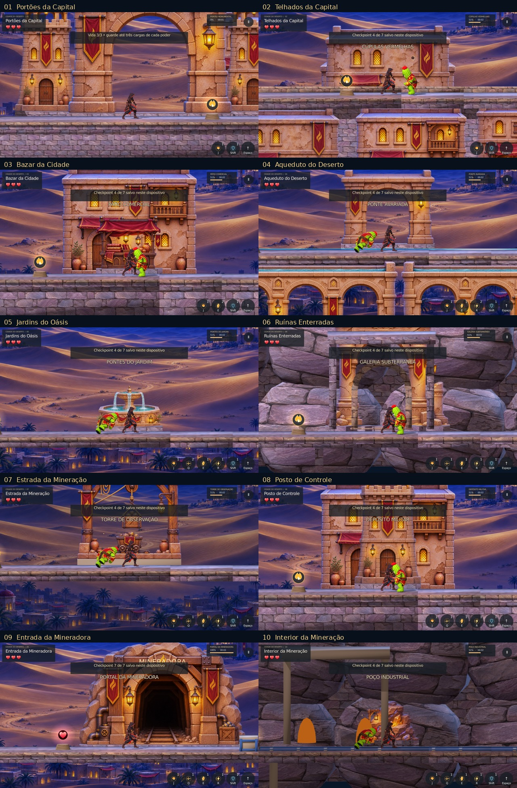

# Dez fases com os assets aprovados — integração

Godot4.7.2 oficial. Implementação8a8fc45 na branch work/reino-deserto-10-fases.
A QA precedeu a publicação; o dono autorizou posteriormente merge/main e Pages.
Confira o resultado do deploy no workflow, além destes testes locais. As evidências anteriores registram etapas
históricas; esta pasta documenta a integração atual dos quinze módulos aprovados.

## Resultado

- Runner consolidado:17 etapas aprovadas, incluindo as dez travessias completas.
- Mecânicas103/0; layout130/0; chefe/mineração6/0; progresso30/0; variedade15/0;
  checkpoints21/0; teclado/mouse/toque10/0. Logs e resultados em qa/.
- Integração de arte86/0:63 âncoras instaladas,15 módulos usados,10 cenas abertas,
  fachadas/ponte por peça física e subterrâneos sem céu. qa/approved_assets.log.
- Travessias1–10:11 verificações por percurso, zero falhas. Entradas e itens reais,
  sem teleporte, invulnerabilidade, atribuição de vida ou redução dos atributos do
  chefe. O piloto da arena vira antes do congelamento e usa choque contra guardas.
  As tentativas anteriores que falharam não integram o resultado consolidado.
- 63 capturas reais em1672×941,844×390 e640×360. Cada perfil abre todas as dez
  fases; captura início, centro de piso do setor5 e portal final9. As imagens
  intermediárias/portal são fixtures teleportadas identificadas em capture.json;
  elas não substituem a prova de travessia. O painel mantém os quadros inteiros.
- Dez capas nativas atualizadas sem HUD,512px. O enquadramento de autoria da
  capa1 é mais aberto para caber o portão; a câmera jogável não usa esse zoom.
- Export Web de produção concluído. Testes, evidências e PNGs de autoria excluídos
  do pacote. Fixture separada, bloqueando destinos externos e sem backend.
- Chromium real com UA iPhone,844×390,DPR3: oito quadros por toque, leitura sem
  avanço automático, dash, persistência após reload, bloqueio dos poderes nos
  capítulos iniciais, perseguição na laje e abertura das dez fases com arte.
  web/report.json: errors=[],engineErrors=[],blocked=[].
- PWA29/0, design checker e proteção de escopo aprovados.

## Limites das verificações

Não houve teste em Safari/iPhone físico, Android ou Windows, nem OAuth ou serviços
online. Emulação Chromium e capturas do motor não demonstram esses aparelhos.
Travessias do piloto duram aproximadamente quatro minutos; balancear com jogadores.
Picos de tempo permanecem nos logs de execução em software, sem descarte. Não são
benchmark de renderização ou garantia de FPS em dispositivo. Há avisos ocasionais
de liberação de playback/ObjectDB no encerramento de testes; as galerias finais
não contêm erros de script/importação.

A primeira tentativa Web excedeu o timeout de captura de30s durante a renderização
em software concorrente com outras verificações. A rodada final foi executada
com esses trabalhos encerrados, timeout explícito de120s e fechamento do navegador
em caso de falha. Não se infere tempo de carregamento em hardware real dessa QA.
A direção da Ruptura ao olhar à esquerda tem teste nativo próprio; o teste Web
valida toque do dash, navegação/leitura e abertura/arte, não todas as habilidades.

## Reprodução

`tests/desert_night/run.py`, `approved_assets_test.gd`, `capture_reino10.py` e
`web_desert_probe.cjs` contêm as provas. Usar templates Web4.7.2, Xvfb para janelas
e perfis de teste isolados. Para PWA neste ambiente: QSE_CHROMIUM_EXECUTABLE=/usr/bin/chromium.
